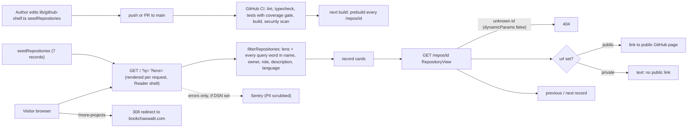
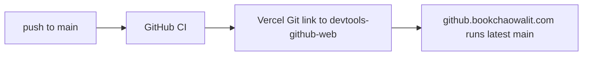

# 01 — Business process (As-Is / To-Be)

devtools-github-web คือ "Repository Reading Room" ชั้นหนังสือของ repository 7 รายการที่เขียนมือในโค้ด (หนึ่งรายการเป็น private จึงไม่มีลิงก์) ผู้เยี่ยมชม portfolio ค้นหา กรองตาม lens และเปิดอ่านรายละเอียดรายตัวที่ `/repos/<id>` ได้ ไม่มีการเรียก GitHub API, API route หรือ storage

Last reviewed: 2026-11-28 · commit `cd852ed`

## As-Is (จากโค้ดวันนี้)

Sources: `lib/github-shelf.ts`, `components/shelf-views.tsx`, `app/page.tsx`, `app/repos/[id]/page.tsx`, `next.config.ts`, `lib/sentry.ts`, `.github/workflows/ci.yml`, `README.md`, `PRODUCT.md`

ข้อเท็จจริงสำคัญจากโค้ด:

- ข้อมูลทุกรายการเขียนมือและตรวจเทียบ GitHub ด้วยคน ณ วันที่แก้ (คอมเมนต์ในโค้ด: ตรวจ 2026-11-19); ไม่มีขั้นตอนอัตโนมัติ sync กับ GitHub
- ไม่มี API route และไม่มี MCP route (ถอนออก 2026-10-15)
- ไม่มี workflow deploy ใน repo; ตาม PRODUCT.md (2026-10-23) deploy ด้วย Vercel CLI และ Git link ชี้ repo เก่า [ต้องยืนยัน] สถานะวันนี้
- `NEXT_PUBLIC_SENTRY_DSN` บน production: [ต้องยืนยัน]

## To-Be (จาก PRODUCT.md §Live URL and deploy state)

Sources: `PRODUCT.md` (CVE patch deploy queued; owner action D9)

## Gap

| ID | As-Is → To-Be | Status | Owner | Evidence |
|---|---|---|---|---|
| G1 | deploy ด้วย CLI, Git link ชี้ repo เก่า, deploy ล่าสุดก่อน CVE patch → เชื่อม Vercel Git กับ `devtools-github-web` และ deploy main ล่าสุด | decide | owner | `PRODUCT.md` §Live URL and deploy state, owner action D9 [ต้องยืนยัน] สถานะปัจจุบัน |

## Open questions

- Vercel Git link ของโปรเจกต์ `bookchaowalit-github-frontend` ยังชี้ repo เก่าอยู่หรือไม่ และ production รัน commit ไหน
- `NEXT_PUBLIC_SENTRY_DSN` ตั้งบน production หรือไม่
